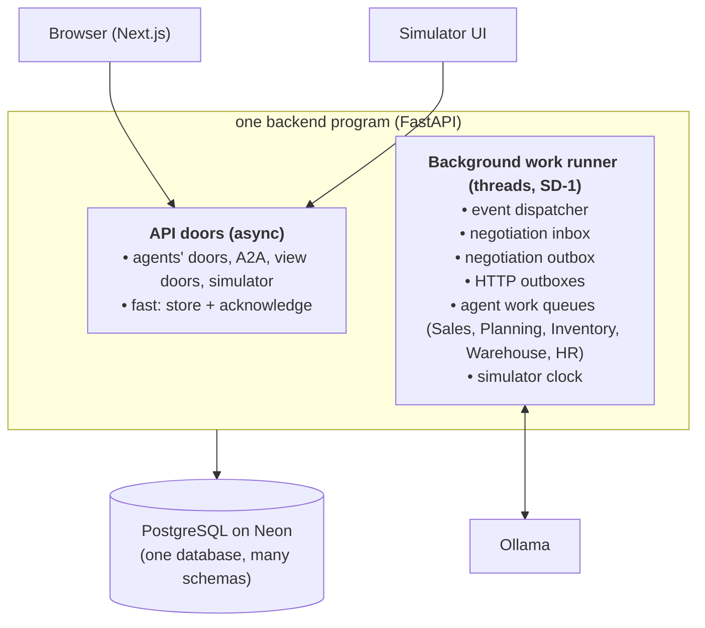

# System Design

**Status:** APPROVED by the developer (2026-10-17). Nothing new here is implemented.
**Related:** `high_level_architecture.md`, `pubsub_event_channel.md`, `negotiation.md`, `quantity_accounting.md`, the
agent folders, `../DECISIONS.md`.

## 1. Purpose

How the whole prototype runs: programs and background work, database layout and connections, the shared work runner,
clock, settings, AI calls, failure handling, observability, security and tests. It collects decisions made in the
other docs and adds the runtime rules that connect them.

## 2. Decisions (2026-10-17)

| ID | Decision |
| --- | --- |
| SD-1 | Background workers run **inside the FastAPI backend** for now, but all pending work is stored in PostgreSQL; workers claim it safely, retry, track attempts and never repeat a business action. Worker code is separate from agent logic so it can move to its own process without rewriting agents (§4). |
| SD-2 | Factory settings are stored in the database per simulation run (simulation schema), saved with a starting state and changed only through validated operations; technical settings stay in environment variables. |
| SD-3 | Every AI model call is logged in a small table (`observability.llm_calls`). |
| SD-4 | No cap on parallel AI calls from our side; Ollama queues them. Each call has a timeout and a deterministic fallback. A cap is added only if Phase 6 measurements show a need. |

## 3. Programs

- **API doors never wait for the AI model.** They validate, store and answer at once ("received"). All slow work
  (AI calls, negotiations, HTTP sends) runs in the background work runner.
- The runner uses **its own threads**, not the server's request thread pool, so long AI calls cannot block API
  requests. (The current Sales Agent uses FastAPI `BackgroundTasks`, which share the request thread pool — it moves to
  the runner during integration, §4.5.)

## 4. The shared work runner (SD-1)

### 4.1 Separation

| Part | Lives in | Knows about |
| --- | --- | --- |
| Work runner (claim, lease, retry, backoff, scope exclusion, loops, start/stop) | `backend/app/core/work_runner.py` | Tables of a standard shape; nothing about business |
| Handlers | Each agent (`<agent>/manager.py`) | Business logic; receives one work item and a session factory; knows nothing about threads |
| Registration | Each agent's `worker_setup.py` | Which queue table + which kinds → which handler |
| Start | FastAPI lifespan (today); a separate entry point `python -m app.worker` (later) | Calls the same registrations |

Moving to a separate worker process later = run the same registrations from a second entry point. Agents do not
change.

### 4.2 Standard queue shape

Every queue table (event deliveries, negotiation inbox and outbox, agent work items, HTTP outboxes) has these
columns: `id`, `seq` (strict order, added in step 1), `scope_key`, `kind`, `payload`, `status` (PENDING, RUNNING, DONE, FAILED; event deliveries also IGNORED_STALE), `attempts`,
`next_attempt_at`, `locked_by`, `locked_until`, `last_error`, `created_at`, `done_at`.

`scope_key` is the "one at a time" unit: an order (Planning), an item (Inventory), the constant `warehouse` / `hr`
(one writer, WB-2 / HB-2), an entity key (event ordering, EV-4), a conversation (Sales).

### 4.3 Two run modes

| Mode | For | How |
| --- | --- | --- |
| **Short** | Quick deterministic handlers (event handlers, inbox, Inventory / Warehouse / HR answers) | One transaction: claim the row (`FOR UPDATE SKIP LOCKED`), run the handler, mark DONE, commit. Crash → the transaction is undone and the row is claimed again. |
| **Long** | Work with AI calls or HTTP sends (Planning cases, Sales turns, outbox sends) | Short claim transaction sets RUNNING + `locked_until` (lease, starting value 2 min, renewed while working). The work runs **without** an open transaction; each business write is its own short transaction with an idempotency key. Crash → lease expires → another worker takes it over and the idempotency keys stop repeats. |

### 4.4 Rules that make it safe

- **Claim:** a PENDING (or expired RUNNING) row whose `next_attempt_at` has passed, **and** no other RUNNING row and
  no earlier PENDING row with the same `scope_key` (one at a time, in order). Database row locks only (works with
  Neon's pooled connections); no in-memory locks, no session-level advisory locks.
- **Retry:** failure → `attempts + 1`, `next_attempt_at` by backoff (1 s, 5 s, 30 s, 2 min), after 5 attempts FAILED,
  shown in the timeline, staff flag; a manual retry door re-queues it (`pubsub_event_channel.md` §6.4).
- **No duplicate business actions:** every write carries an idempotency key that is unique in the database —
  `source_id` + line in the ledgers (QA-1), `message_id` in negotiation, `event_id` in events, `request_ref` /
  `delivery_id` / `absence_id` at the doors. A repeated attempt finds the key and changes nothing.
- **Work from data:** handlers re-read the current state before acting (the Sales pattern "answer everything
  unprocessed"), so a lost trigger only delays work, never loses it.
- **Startup:** nothing is "released" at startup; expired leases make stuck work claimable. (A startup release would
  steal running work from another process.)

### 4.5 What must change before running several backend processes

The new design is multi-process safe by construction (database claims, leases, idempotency keys). These existing
parts are not, and must change first:

| Part | Problem | Change |
| --- | --- | --- |
| Sales `_accept_lock` (`threading.Lock`) | Works only inside one process | Rely on the unique `provider_message_id`; treat the conflict as "duplicate" |
| Sales `busy` flag + `release_stuck_conversations` at startup | No expiry; startup release steals work | Move Sales turns to the work runner (scope = conversation, long mode with lease) |
| Sales `BackgroundTasks` | In memory, shares the request thread pool | Enqueue a work item instead |
| Settings cache (`lru_cache` in `config.py`) | Fine for technical settings; factory settings must not be cached forever | Read factory settings with their version (SD-2) |
| Simulator clock | Two processes could both start a day | One clock row in the database; advancing it is a claimed work item |
| Old `agents/workflow.py` in-memory locks | Old design | Retired in Phase 2 |

Until those are done: **run exactly one backend process.**

### 4.6 Worker counts (starting values, tuned in Phase 6)

Event dispatcher 4 · negotiation inbox 2 · negotiation outbox 2 · HTTP outboxes 1 · Sales 2 · Planning 4 ·
Inventory 4 · Warehouse 1 · HR 1 · clock 1.

## 5. Database layout

One Neon PostgreSQL database (`DATABASE_URL`; tests `TEST_DATABASE_URL`).

| Schema | Owner | Contents |
| --- | --- | --- |
| `core` | Shared reference (simulator configuration) | items, BOM, routings (PD-2) |
| `sales_agent` | Sales | Existing 9 tables |
| `planning` | Planning | `planning_agent/4_…` |
| `inventory` | Inventory | `inventory_agent/4_…` |
| `warehouse` | Warehouse | `warehouse_agent/4_…` |
| `hr` | HR | `hr_agent/4_…` |
| `purchasing` | Purchasing | Later (Purchasing doc) |
| `events` | Event channel | `events`, `event_deliveries` |
| `negotiation` | Negotiation layer | Sessions (with `case_id`), messages (+ inbox columns), outbox |
| `simulation` | Simulator | Runs, factory settings, saved starting states, clock (details in `demo.md`) |
| `observability` | Shared | `llm_calls` (SD-3) |

Old tables (`sales`, `agent`, `audit`, old `planning` / `inventory` / `purchasing` / `negotiation` tables) stay until
the Phase 2 review retires them.

**Connections:** a thread holds a connection only during a transaction (long-mode work never holds one while waiting
for the AI). Starting pool: 10 + 10 overflow per process, configurable. Use Neon's pooled endpoint; our locks are
row locks inside transactions, which work there. Verify the database driver's prepared-statement setting against
the pooler during Phase 3 (not checked yet).

## 6. Settings (SD-2)

| Kind | Where | Examples | Changed by |
| --- | --- | --- | --- |
| Technical | Environment variables (`core/config.py`) | `DATABASE_URL`, Ollama URL and model, AI timeouts, worker counts, pool size | Restart |
| Factory | `simulation` schema, per run, versioned | Safety-stock limits, overtime limits, capacities, zone sizes, horizon, time fence, dampener, hold validity, release lead | Demo operator through validated operations; saved with a starting state |

Agents read factory settings through the simulator's read module and use the version they read in their audit
records, so a decision can be explained later.

## 7. AI model calls (SD-3, SD-4)

- One shared model via Ollama (`qwen3.5:4b`, configurable). AI calls happen only in background work, never in API
  requests, never inside an open database transaction.
- Every call has a timeout (Sales 60 s, Planning 30 s, owners' wording 15 s; configurable) and a deterministic
  fallback (fixed ranking or template).
- **`observability.llm_calls`:** id · run_id · agent · purpose (e.g. SALES_TURN, PLANNING_RANKING, WORDING) · case_id ·
  queued_at · started_at · finished_at · outcome (OK, TIMEOUT, INVALID, ERROR, FALLBACK_USED) · prompt_chars ·
  output_chars · model. No prompt text (it may contain customer messages); the agent's audit keeps what is needed.
- No cap on parallel calls from our side (SD-4).

## 8. Simulated time

- One simulated clock per run (stored in `simulation`), separate from real time.
- Advancing the clock publishes `SimulatedDayStarted(date)` (PB-3). How and when it advances (button, automatic
  interval) is decided in `demo.md`.
- Agents use the simulated date for all business dates; real time only for retries, leases and timeouts.

## 9. Failure handling

| Failure | Effect | Handling |
| --- | --- | --- |
| Backend crashes | Running work stops | Short mode: transaction undone; long mode: lease expires; outboxes resume; nothing lost |
| Database unreachable (Neon idle) | Requests fail briefly | `pool_pre_ping`, connection retry; doors answer "service unavailable"; work retried by backoff |
| AI model down / slow / invalid | No AI answer | Deterministic fallback; logged in `llm_calls`; Sales staff flag after repeated failures |
| A2A send fails | Message not delivered | Negotiation outbox retries; duplicate acknowledged as success |
| Event handler fails | Delivery not done | Retries, then FAILED + staff flag; later events for that entity wait (EV-4) |
| Stale fact | Decision on old data | Version checks; owners re-check at commit; stale events ignored |
| Poison work item | Fails every time | FAILED after 5 attempts; visible; manual retry door |
| Two copies of a request | Possible double action | Idempotency keys (§4.4) |
| Clock advanced twice | Day processed twice | Clock row + idempotent daily routines (each step its own work item) |

## 10. Observability

- **Correlation:** every event, negotiation message, work item and audit row carries `case_id` / `correlation_id`;
  events also carry `causation_id`.
- **Timeline** for the demo is built from `events`, `event_deliveries`, negotiation messages, agents' audit logs and
  `llm_calls` (details in `demo.md`).
- **Measurements** for Phase 6: delivery lag, attempts, work-item wait and run time, negotiation duration, AI call
  times, end-to-end order time.

## 11. Security (prototype)

Local demo, no user login. Shared keys on machine-to-machine doors (Sales door 3, Planning door 1, simulator inputs);
view doors open on localhost only. No real personal data (HD-2). Real authentication is future work.

## 12. Testing approach

| Level | What | Needs |
| --- | --- | --- |
| Pure | Calculations (`mrpii/`, agents' `calc.py`), ranking, rules | Nothing |
| Agent | Handlers with fake AI, fake read modules, fake negotiation partners | Test database |
| Runner | Claim, lease expiry, retry, scope exclusion, idempotency | Test database, two runner instances |
| Flow | Research report example end to end, six disruptions | Test database, fake AI, simulated clock |
| Live | One run with the real model, skipped by default | Ollama |

## 13. Open

| ID | Question |
| --- | --- |
| SD-O1 | Lease length and renewal interval (starting 2 min / 30 s). |
| SD-O2 | Driver prepared-statement setting with Neon's pooler (check in Phase 3). |
| SD-O3 | Resolved 2026-10-17: `demo.md` §6 (clock) and §5, §12 (states, reset). |
| SD-O4 | When to move the Sales Agent onto the work runner (integration phase; §4.5). |
